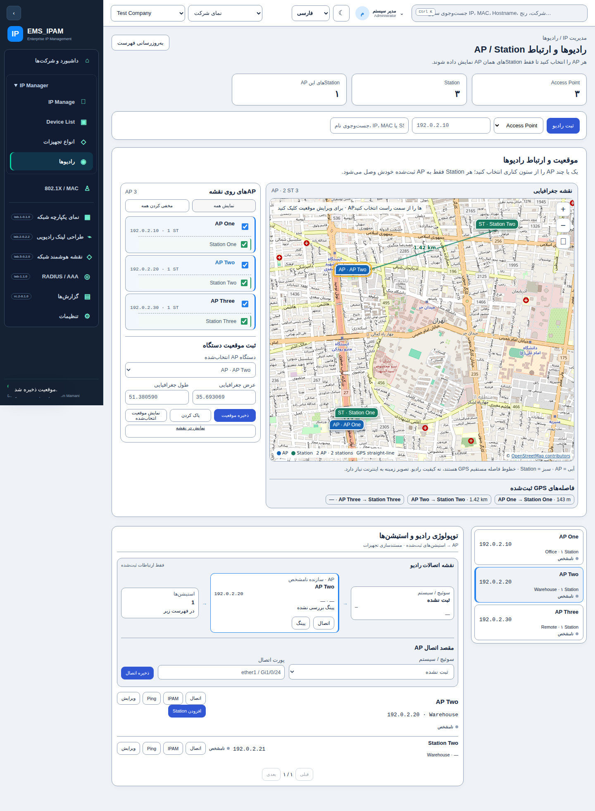
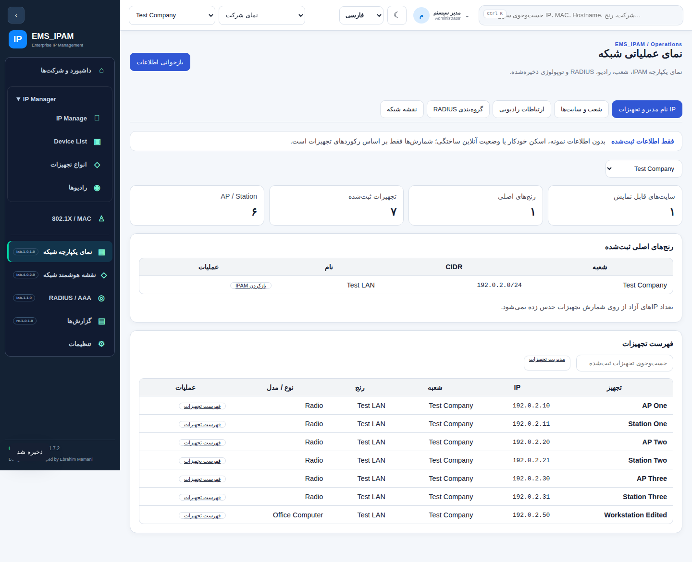
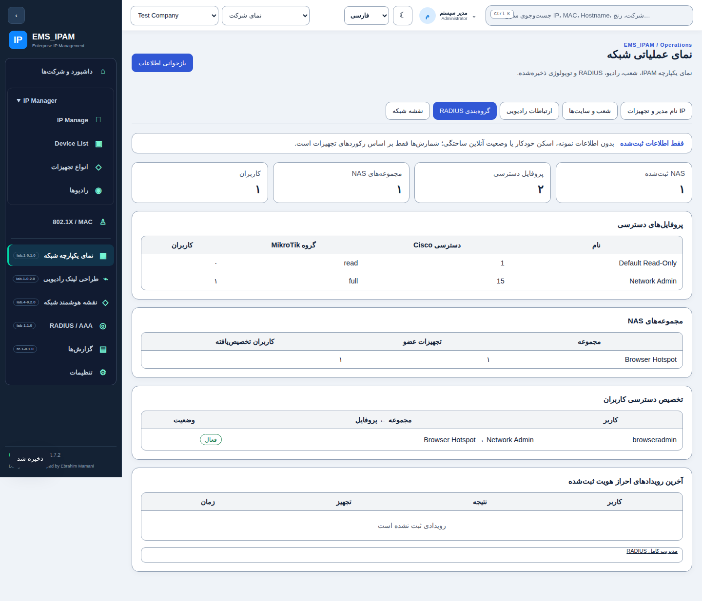
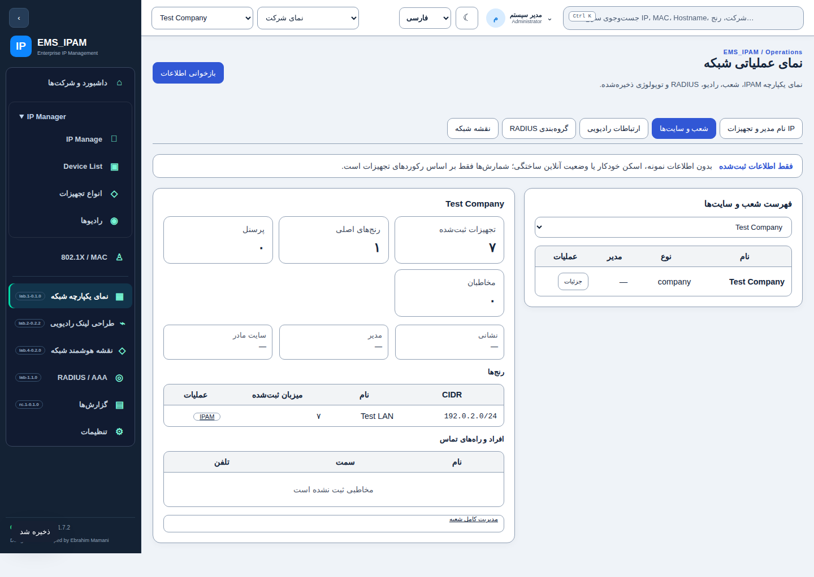
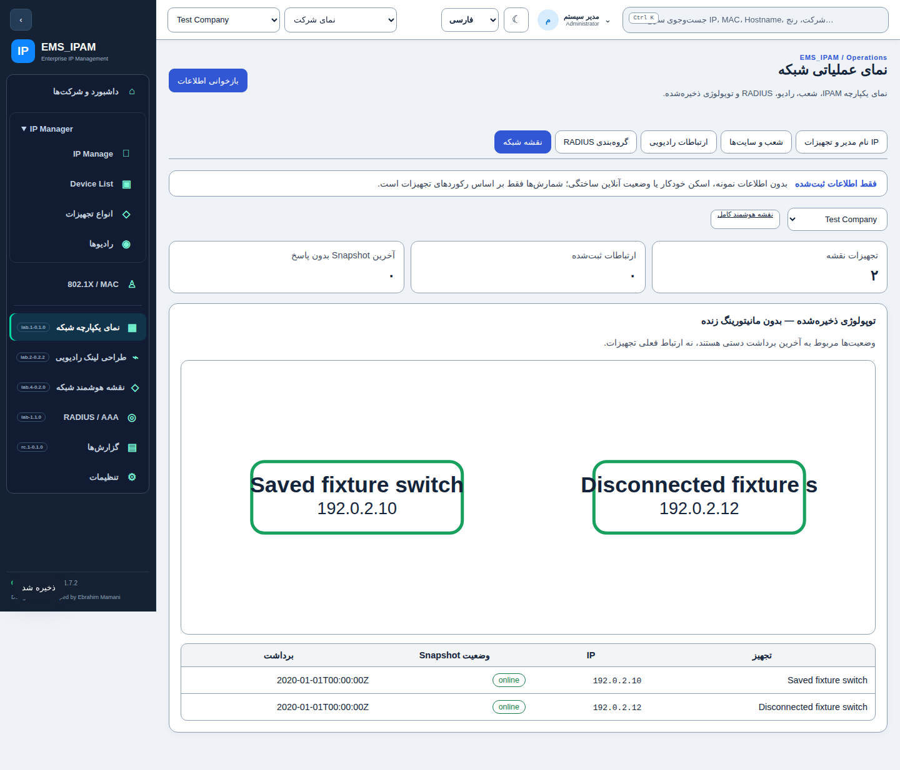

# EMS_IPAM

**IP Management · Network Inventory · RADIUS Device Access · Radio Topology**

پنل یکپارچهٔ مدیریت و مستندسازی شبکه برای مدیران شبکه؛ با رابط فارسی/انگلیسی و اجرای Docker. هدف پروژه این است که اطلاعات IP، تجهیزات، شعب، دسترسی‌ها و نقشه‌ها در یک محیط قابل پیگیری باشند.

**نسخهٔ فعلی: 1.7.1** · **Radio: 2.3** · **Windows Client: 0.8.0**  
[نصب سریع](#-نصب-سریع) · [تصاویر واقعی](#-نمای-واقعی-محیط) · [قابلیت‌ها](#-قابلیتهای-نسخهٔ-فعلی) · [محدودیت‌ها](#-وضعیت-تست-و-محدودیتها) · [مستندات](#-مستندات) · [Support](#-حمایت-از-توسعه)

---

## 📷 نمای واقعی محیط

### Radio Management — نقشهٔ هم‌زمان چند AP

- نقشهٔ بزرگ مرکزی با پنل اطلاعات و انتخاب AP/Station در سمت راست
- نمایش هم‌زمان چند AP و Stationهای هرکدام، با خطوط اتصال به AP والد
- نمایش موقعیت ذخیره‌شده و فاصلهٔ مستقیم GPS؛ انتخاب نمایش همه یا مخفی‌کردن همه
- جدول مشترک **Radio Topology & Stations** پایین نقشه

| IP Manager و Inventory | RADIUS Device Access |
|:---:|:---:|
|  |  |
| **شعب و سایت‌ها** | **نقشهٔ شبکه؛ آخرین Snapshot ذخیره‌شده** |
|  |  |

**دربارهٔ تصاویر:** همهٔ تصاویر بالا از رابط واقعی EMS_IPAM در تست مرورگر، با دیتابیس و داده‌های **آزمایشی** گرفته شده‌اند؛ تصویر تولیدشده با هوش مصنوعی نیستند و اسکرین‌شات VM یا تجهیزات واقعی کاربر محسوب نمی‌شوند.  
[تمام تصاویر آزمایشی](docs/screenshots/real) · [تصویر نمایش رمز RADIUS برای مدیر](docs/test-results/radius-1.1.0-password-display.png) · [گزارش انتشار Radio 2.3](docs/releases/v1.7.1.md)

## 🚀 نصب سریع

روی **Ubuntu/Debian** با دسترسی **sudo** و اینترنت، دستور زیر را اجرا کنید:

~~~bash
sudo bash -c 'set -e; command -v curl >/dev/null || { apt-get update; apt-get install -y ca-certificates curl; }; EMS_SETUP=$(mktemp); trap "rm -f \"$EMS_SETUP\"" EXIT; curl -fsSL --retry 3 https://raw.githubusercontent.com/emsebi/EMS_IPAM/main/install.sh -o "$EMS_SETUP"; bash "$EMS_SETUP"'
~~~

در منوی نصب‌کننده:

- **گزینهٔ 1:** نصب تازه
- **گزینهٔ 2:** ارتقای نصب موجود، همراه با تهیهٔ بکاپ دیتابیس پیش از تغییر
- **پورت پیش‌فرض پنل:** 8080؛ پس از نصب، آدرس ورود نمایش داده می‌شود

نصب‌کننده پیش‌نیازهای Docker Engine و Compose را بررسی می‌کند. **Portainer اختیاری است.** این دستور فایل نصب را از شاخهٔ **main** دریافت می‌کند؛ برای ارتقای نصب دارای دادهٔ مهم، قبل از اجرا بکاپ مستقل و قابل بازیابی داشته باشید. مهاجرت دیتابیس با بازگرداندن صرفِ فایل‌های نسخهٔ قبلی به عقب برنمی‌گردد.

[دانلود ZIP سورس](https://github.com/emsebi/EMS_IPAM/archive/refs/heads/main.zip) · [راهنمای نصب دستی و تست](START-HERE-FA.md) · [راهنمای ارتقای نسخهٔ 1.7.1](docs/releases/v1.7.1.md)

## 🧩 قابلیت‌های نسخهٔ فعلی

| ماژول | قابلیت قابل استفاده | وضعیت |
|---|---|---|
| **IP Manager / Inventory** | ثبت و جست‌وجوی رنج، IP، تجهیزات، Device Types، شعب و اطلاعات مرتبط | موجود |
| **Radio Management 2.3** | نقشهٔ چند AP، ارتباط AP→Station، مختصات PostgreSQL، فاصلهٔ GPS و Ping دستی | موجود؛ مستندسازی |
| **RADIUS Device Access** | NAS، NAS Collections، پروفایل، کاربران، گزارش و مدیریت Secret؛ بدون نیاز به Company در بخش RADIUS | موجود؛ پذیرش روی روتر واقعی باز |
| **Operations Overview** | نماهای تجمیعی IPAM، سایت‌ها، Radio، RADIUS و آخرین Snapshot شبکه | آزمایشی |
| **Smart Network Map** | نقشهٔ دستی، Snapshot و پردازش آفلاین LLDP/CDP | تکمیل جزئی |
| **MAC / 802.1X / NAC** | ثبت اطلاعات MAC و پرسنل | اعمال عملی سیاست هنوز پیاده‌سازی نشده |
| **Windows Client 0.8.0** | اجرای اتصال WinBox، RDP، SSH، Telnet و VNC از پنل | موجود |

### کلاینت ویندوز

[دانلود EMS-IPAM Windows Client 0.8.0](https://raw.githubusercontent.com/emsebi/EMS_IPAM/main/docker-app/public/downloads/EMS-IPAM-Windows-Client-v0.8.0.zip)

فایل ZIP را استخراج و **Install.cmd** را اجرا کنید. برای اتصال WinBox می‌توانید **Configure-WinBox.cmd** را به کار ببرید. اگر مرورگر برنامه را پرسید، فایل زیر را انتخاب کنید:

~~~text
%LOCALAPPDATA%\EMS-IPAM-Client\EMS-IPAM-Client.exe
~~~

[راهنمای کلاینت و رفع مشکل انتخاب WinBox](docs/WINDOWS-CLIENT-FA.md)

## 🧪 وضعیت تست و محدودیت‌ها

**نسخهٔ 1.7.1 یک نقطهٔ انتشار برای قابلیت‌های موجود است، نه اعلام تکمیل تمام پروژه.**

- تست‌های خودکار Core، مرورگر، API، PostgreSQL و Docker در CI اجرا می‌شوند. [آخرین اجرای موفق ثبت‌شدهٔ main در ۱۲ نوامبر ۲۰۲۶](https://github.com/emsebi/EMS_IPAM/actions/runs/43165947423) مربوط به کامیت آزموده‌شدهٔ آن اجراست؛ انتشار بعدی تصاویر به‌معنای تست مجدد کد روی تجهیزات واقعی نیست.
- کشف کاملاً خودکار توپولوژی، MAC Trace و اعمال 802.1X/NAC هنوز تکمیل نشده‌اند.
- ورود واقعی RADIUS به RouterOS و تفاوت سطوح **Full / Read** باید روی دستگاه عملی بررسی شود.
- خطوط Radio فاصلهٔ مستقیم موقعیت‌های ثبت‌شده را نشان می‌دهند، نه کیفیت یا مانیتورینگ زندهٔ لینک. کاشی‌های OpenStreetMap برای نمایش آنلاین به اینترنت نیاز دارند.
- Snapshot شبکه و آخرین Ping ثبت‌شده نباید با وضعیت زندهٔ شبکه اشتباه گرفته شوند. هیچ ارتباط یا Push خودکاری به تجهیزات نباید بدون درخواست و مجوز اجرا شود.
- نصب موفق در CI، جایگزین بکاپ، استقرار روی VM و آزمون عملی اپراتور نیست.

## 📚 مستندات

| راهنما | موضوع |
|---|---|
| [START-HERE-FA](START-HERE-FA.md) | نصب، راه‌اندازی و عیب‌یابی |
| [انتشار 1.7.1](docs/releases/v1.7.1.md) | تغییرات، محدودیت‌ها و مسیر ارتقا |
| [آزمون‌ها](docs/TEST-REPORT-FA.md) | گزارش تست‌های ثبت‌شده |
| [نقشهٔ راه](docs/ROADMAP-FA.md) | مسیر ادامهٔ توسعه |
| [معیار حفظ امکانات](docs/FEATURE-ACCEPTANCE-FA.md) | جلوگیری از حذف قابلیت‌های پذیرفته‌شده |
| [نقطهٔ ادامهٔ توسعه](CONTINUATION.md) | وضعیت فنی و گام‌های بعد |
| [Radio Management](modules/radio/README.md) | جزئیات و محدودیت‌های نقشهٔ رادیویی |

## ❤️ حمایت از توسعه

EMS_IPAM یک پروژهٔ عمومی در حال توسعه است. اگر برای شما مفید بود، حمایت مالی کاملاً اختیاری است.

*EMS_IPAM is a Docker-based network administration and documentation project with IPAM, inventory, RADIUS access management, and radio topology views. Screenshots show the real web UI running against test fixtures, not a production deployment. Hardware acceptance and some planned modules remain in progress.*

| دارایی | شبکه | آدرس دریافت |
|---|---|---|
| **USDT** | **TRON (TRC20)** | TTtgCYCdWR8PxdacyWgaRPX6cj4raD2BxH |
| **BTC** | **Bitcoin** | bc1qy5ktdduz7p23nds67u4tmpa3se4cetxsnurzr0 |

| USDT / TRC20 | Bitcoin |
|:---:|:---:|
|  |  |

**طراح پروژه:** Ebrahim Mamani / ابراهیم مامانی
