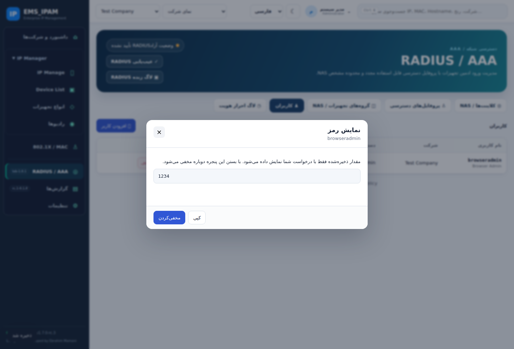

# اصلاح نمایش رمز — RADIUS / RADIUS Operations 1.0.1-lab

تاریخ: ۲۰۲۶-۱۰-۲۶. Core روی 1.7.0-rc.3 باقی می‌ماند؛ اصلاح در دو ماژول مستقل انجام شده و تغییر schema یا رمز موجود ندارد.

## اصلاح

حذف قبلی نمایش رمز با بستن endpointها و حذف دکمه‌ها، خلاف قابلیت مورد انتظار کاربر بود. دکمهٔ «نمایش رمز» در فهرست کاربران و فرم ویرایش کاربر و «نمایش Secret» در پروفایل‌های Secret و فرم NAS بازگردانده شد. پنجرهٔ نمایش، مقدار واقعی ذخیره‌شده را با درخواست مدیر دریافت می‌کند؛ کپی و انتخاب دستی دارد و با بسته‌شدن پاک می‌شود. فهرست‌های عادی و Audit مقدار رمز را شامل نمی‌شوند. مشاهدهٔ رمز، ورودی جدیدِ ذخیره‌نشده در فرم ویرایش را از بین نمی‌برد.

تست‌های قبلی که نبودِ قابلیت و 403 برای مدیر را موفق می‌دانستند اصلاح شدند. نسخهٔ manifest هر دو ماژول تغییر کرده تا رابط جدید از cache قدیمی بارگذاری نشود. [قرارداد حفظ امکانات](../FEATURE-ACCEPTANCE-FA.md) مبنای ادامهٔ کار است.

## نتیجهٔ محلی

- ۱۸۸ تست Core/API و ۴۲ تست ماژول‌ها موفق.
- ۱۶ سناریوی مرورگر/API واقعی با دیتابیس موقت PGlite موفق؛ شامل نمایش، کپی، مخفی‌کردن، حفظ فرم ویرایش، منع کاربر غیرمدیر و سایر جریان‌های قبلی.
- [گزارش مرورگر](../test-results/radius-1.0.1-browser-result.json) و تصویر زیر از داده‌های صرفاً آزمایشی هستند.
- [CI کد اصلاح‌شده موفق شد](https://github.com/emsebi/EMS_IPAM/actions/runs/40232903844)؛ CI مربوط به commit ادغام‌شده نیز [موفق است](https://github.com/emsebi/EMS_IPAM/actions/runs/40233050436).
- [نصب روی VM اختصاصی و smoke واقعی موفق شد](https://github.com/emsebi/EMS_IPAM/actions/runs/40233050403). کد نصب‌شده: `051f77be2f89bfd1bad90c2a80a495173088f48d`؛ تنظیمات موجود حفظ و سلامت پنل روی پورت 8888 تأیید شد.
- روی PostgreSQL/FreeRADIUS واقعی، نمایش صریح رمز مدیر، Access-Accept/Reject، سطح دسترسی Cisco/MikroTik، Accounting روی UDP1813، جداسازی شرکت‌ها، چرخش Secret و بازیابی بعد از restart و قطع دیتابیس موفق شدند.
- [اجرای جداگانهٔ مرورگر روی بک‌اند واقعی](https://github.com/emsebi/EMS_IPAM/actions/runs/40233050453) مستقل از تست مرورگر PGlite است؛ هنگام ثبت این گزارش در مرحلهٔ آماده‌سازی Chromium بود و هنوز موفق اعلام نشده است.

