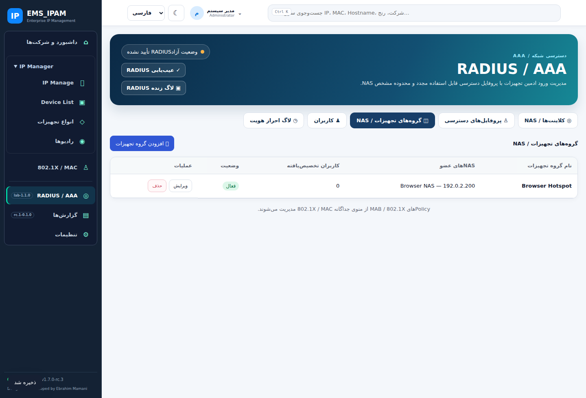
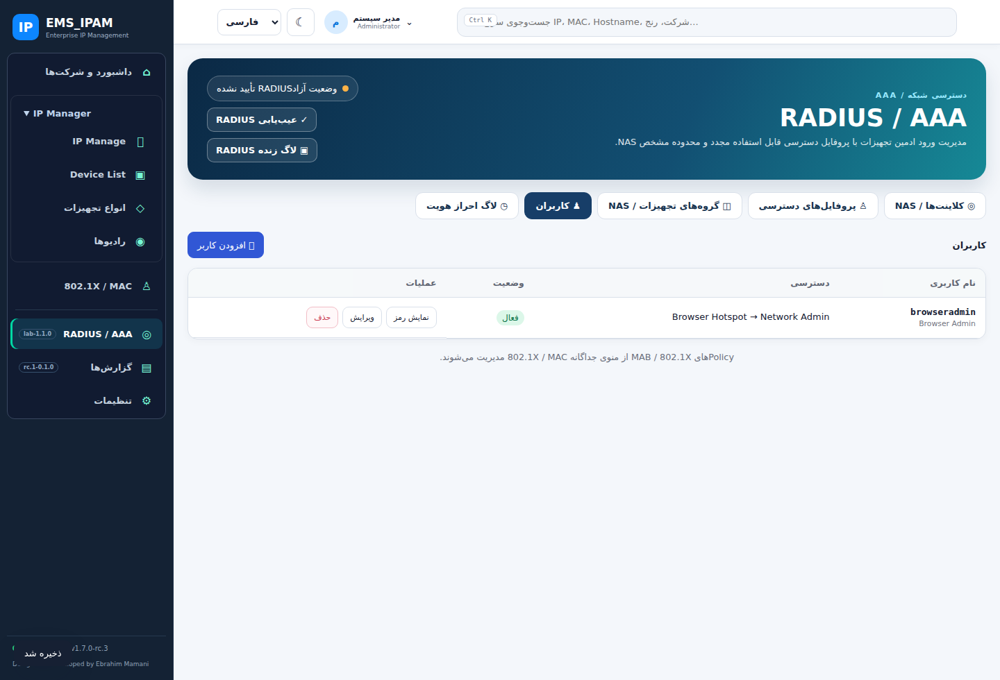
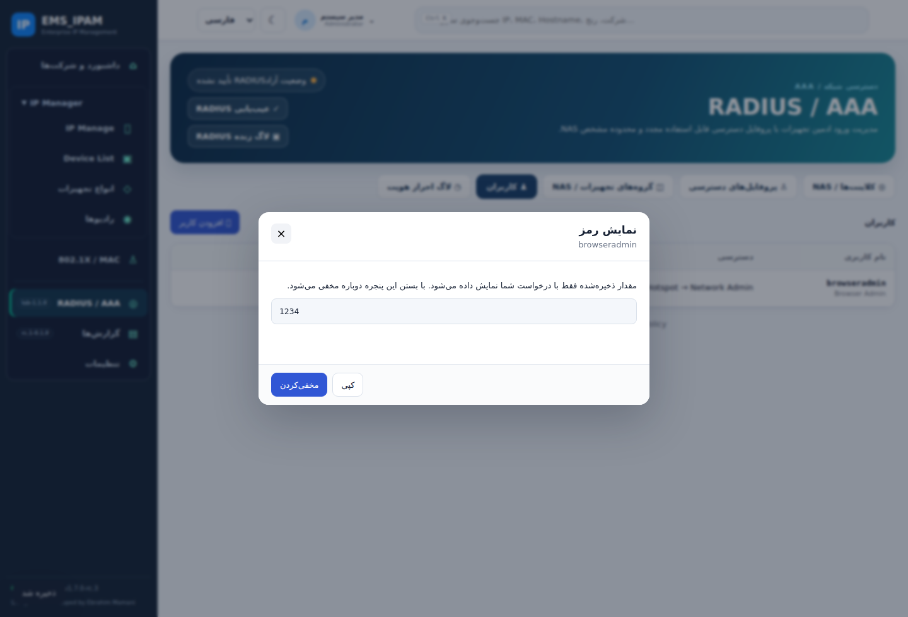

# RADIUS 1.1.0-lab — NAS Collections without Company

RADIUS device administration now uses explicit NAS Collections and permission profiles without asking for a Company. NAS, Shared Secret profiles, permission profiles, collections and user accounts can be created in a database with no Company at all. Existing Core IPAM/Inventory Company data is unchanged.

Migration 013 retains all existing rows, credentials, access rules and inventory links. Legacy Company IDs remain internal compatibility metadata; archived legacy records remain denied. New records have no Company ID. Existing MAB/NAC policy is unchanged. A preflight rejects malformed legacy cross-Company access links so an upgrade cannot silently activate previously denied assignments.

Administrator Show / Copy / Hide for saved account passwords and Shared Secrets is preserved. Editing a NAS in the RADIUS UI also preserves its existing Inventory link. An unassigned user remains denied; conflicting permission profiles for one NAS remain rejected.

Local validation: 16 Chromium browser/API scenarios, 191 Core/API tests (including three Company-free CRUD/upgrade tests) and 42 module tests passed. GitHub CI and real Docker/PostgreSQL/FreeRADIUS/Chromium runs are required before deployment. The dedicated lab workflow saves a private database backup, builds images before stopping containers, and compares existing RADIUS rows after migration. Deployment and real-run links will be recorded after completion.

This release does not close the separate RouterOS Full-to-Read incident. SQL selected full/15 and isolated protocol tests passed, but effective authorization on the user's router still needs router-side evidence; see [incident record](../test-results/radius-authorization-2026-10-28.md).

## Screenshots and test evidence

Synthetic test data only; the screenshots do not contain the installed lab's credentials. Core Company/space selectors are hidden while RADIUS is open and return when navigating to IPAM/other modules.

[Browser report](../test-results/radius-1.1.0-browser-result.json). Three Linux UDP-owner health assertions cannot pass in the local execution environment; the unchanged supervisor suite is verified by GitHub CI on Linux and real Docker checks, not by those local results.
